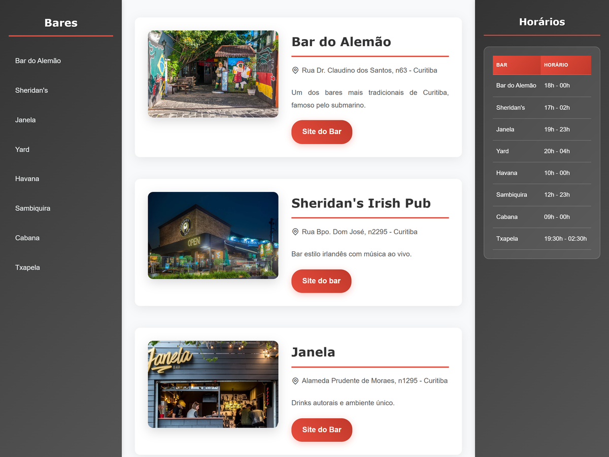

# Curitibars

A static website (HTML and CSS) featuring a short guide to bars in Curitiba: a fixed
side menu, one section per bar with photo, address and description, and a separate
contact form page.

Team project, built jointly with Emelize Bonfim Mlot
([@liz-whs](https://github.com/liz-whs)), who owns the original repository. This is a
fork kept on Giovanna's account for portfolio reference; the work on the pages and
styles was done together.



## Structure

```
.
├── index.html       # bar listing with side navigation
├── formulario.html  # contact form
├── style.css        # listing styles
├── styleform.css    # form styles
└── img/             # bar photos
```

## Running

Open `index.html` in a browser - no build step or dependencies - or visit the live site:
https://ribasgiovanna.github.io/Curitibars/

## Tech

- HTML
- CSS
- Remix Icon (icon font, via CDN)
